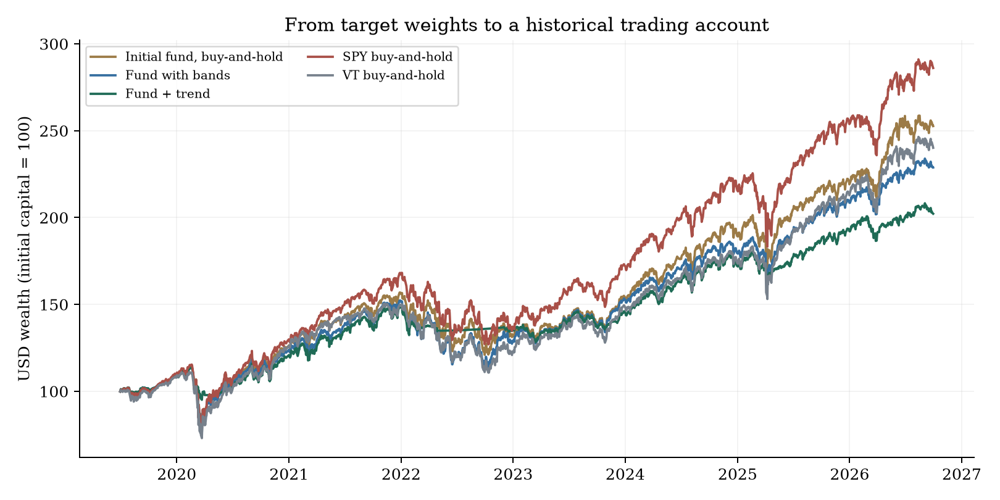
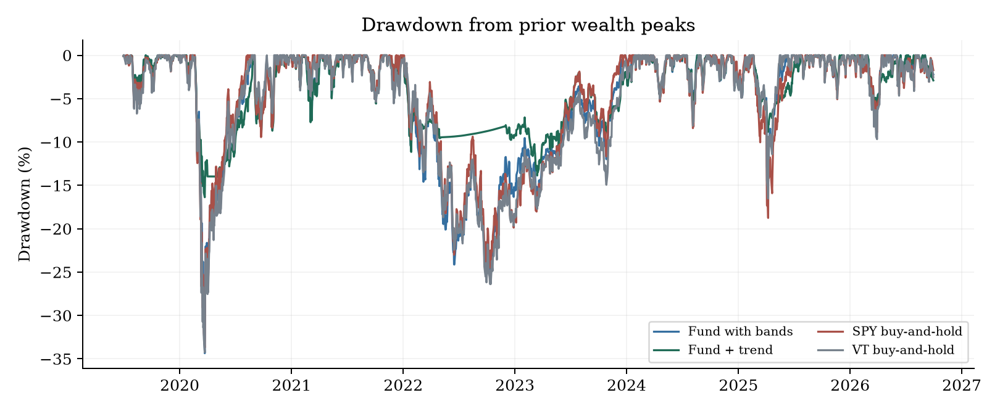
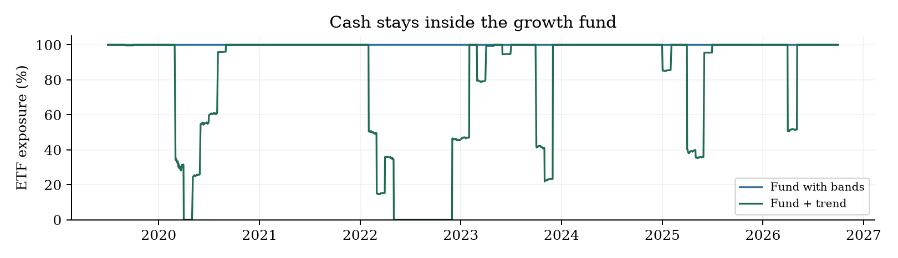
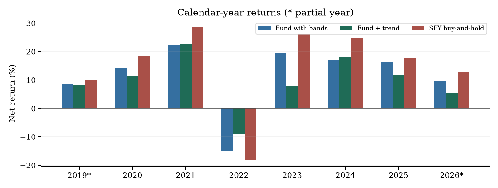

# From ETF Allocation to Automated Trading

Leandro Loli | MSDS 451, Section 001 | Fall 2026 | November 8, 2026

Programming Assignment 3

## 1. From choosing the fund to running it

Earlier assignments defined the jobs of the portfolio, chose ETFs for the growth block, and studied how to divide the money among them. This assignment takes the next step: turning those choices into rules for buying, selling and rebalancing. I then test whether a trend rule helps the fund after costs.

The question moves from what to hold and how much to invest to how to maintain the portfolio over time. The safety and inflation blocks keep their original jobs. This study trades only the growth fund.

### The question

Can a monthly trend rule reduce the fund's losses without giving up too much growth? The optimizer decides how much each ETF should receive. The trend rule decides whether that amount stays in the ETF or moves to cash.

### How the rule works

| Step | Decision |
| --- | --- |
| Choose eligible ETFs | Use the earlier catalogue. Require five years of returns and enough trading volume; remove equivalent wrappers. |
| Set the weights | Update the Checkpoint B allocation using only earlier data. Use no short positions or borrowing. |
| Check the trend | Compare each ETF's month-end USD price with its ten-month average. Keep its target above the average; move it to cash otherwise. |
| Trade later | Use the next available common closing date. Trade when weights leave their bands; charge purchases and sales. |

All 61 catalogue ETFs remain candidates. Between 28 and 38 qualify at each of the 87 monthly decisions. A young fund must build enough history before it can enter.

Each ETF can receive at most 20% at a decision. The fund also has a model-based monthly loss limit. I keep three-percentage-point trading bands: small weight changes can wait, while an ETF rejected by the trend rule must be sold. Appendix A gives the exact rules.

The ten-month rule follows Faber [2]. A sustained decline may continue after a sell signal. A quick recovery can also leave the fund in cash while prices rise. That trade-off is what I test.

## 2. What happened to return and risk?

The test covers 2019-07-01 to 2026-09-30, in USD. I compare the fund with bands, the same fund with trend, and three buy-and-hold controls. The initial-fund control buys the first allocation once. SPY provides the required S&P 500 benchmark; VT adds a global-equity reference.

| Account | CAGR | Volatility | Sharpe | Max DD |
| --- | --- | --- | --- | --- |
| Initial fund, buy-and-hold | 13.64% | 18.75% | 0.624 | -33.93% |
| Fund with bands | 12.10% | 17.79% | 0.570 | -34.35% |
| Fund + trend | 10.20% | 11.06% | 0.674 | -16.37% |
| SPY buy-and-hold | 15.60% | 19.60% | 0.692 | -33.72% |
| VT buy-and-hold | 12.85% | 18.82% | 0.585 | -34.24% |

CAGR is compound annual growth. Volatility measures return variation. Sharpe measures return above the cash proxy relative to its variation. Maximum drawdown is the largest loss from a previous wealth peak.

With trend, CAGR is 10.20%, versus 12.10% for the fund with bands. Sharpe is 0.674, versus 0.570. The filter changes both growth and risk; it does not simply add return to the original fund.

SPY has CAGR 15.60% and Sharpe 0.692. The fund therefore needs to be judged against a simple alternative, even when its own risk measures improve.

I assume a cost of 0.10% of every amount bought or sold. The three fund accounts also pay a 0.25% annual management expense. SPY and VT pay no extra fund-management fee. Cash earns a proxy based on three-month Treasury yields. These are modeling assumptions; Appendix A explains the accounting.

## 3. What does the lower drawdown mean?

The largest fall is -16.37% with trend and -34.35% without it. In this history, leaving some allocations in cash reduced the depth of the loss.

The trend fund holds 80.34% in ETFs on average. That matters: part of the lower risk comes from being less invested. The cash belongs to the growth fund and does not replace the separate safety reserve.

The filter also trades more. Its annual turnover is 1.55 times fund wealth, compared with 0.69 for the fund with bands. Each purchase and sale has a cost.

For the investor, the choice is between more time in the market and a rule that may soften a prolonged decline. The filter can also exit late, miss a recovery or trade repeatedly around the moving average. Monthly decisions leave the fund exposed to losses between signals.

## 4. Is the improvement reliable enough to adopt?

I split the ongoing accounts into an earlier and a later period. Holdings carry across the boundary; the fund does not restart or pay a second entry cost.

| Account | Period | CAGR | Sharpe | Max DD |
| --- | --- | --- | --- | --- |
| Fund with bands | earlier | 7.43% | 0.384 | -34.35% |
| Fund with bands | later | 16.63% | 1.069 | -14.60% |
| Fund + trend | earlier | 8.97% | 0.649 | -16.37% |
| Fund + trend | later | 11.36% | 0.739 | -8.83% |
| SPY buy-and-hold | earlier | 9.38% | 0.457 | -33.72% |
| SPY buy-and-hold | later | 21.73% | 1.086 | -18.76% |

Earlier means July 2019-December 2022; later means January 2023-September 2026. Previous work already examined overlapping dates. This split shows how the result changes over time; it is not a new, untouched test.

I also change trading costs, the trend window, the bands and the execution delay. I keep the ten-month rule as the main result, even if another setting looks better. Appendix B reports every alternative.

A block-resampling check asks how much the Sharpe difference varies when groups of observed months are drawn again. Its 95% interval is [-0.303, +0.425]. It includes zero, so this check does not establish a stable Sharpe advantage. The detailed assumptions are in Appendix B.

### Conclusion: automate the process; keep trend experimental

Automated execution worked: the program turned the policy into delayed trades and accounts that reconcile. The added management rules did not show a clear investment advantage in this sample.

Rebalancing had CAGR 12.10% and Sharpe 0.570. Holding the initial allocation had 13.64% and 0.624. The extra allocation decisions did not improve growth or Sharpe.

Trend delivered protection instead: maximum drawdown changed from -34.35% to -16.37%, while CAGR fell from 12.10% to 10.20%. It softened the worst fall by holding more cash and trading more. That protection had a growth cost; the Sharpe check above does not establish a stable advantage.

My decision for the project is to keep the automated execution and accounting, retain buy-and-hold as the reference, and leave trend out of the default fund policy. The growth block is meant to compound. Adding a cash-exit rule requires deciding how much growth to sacrifice for a smaller drawdown and testing that choice further. This exercise has not justified that change.

This conclusion applies to the tested period and assumptions. The catalogue and data are retrospective, and historical company/sector limits remain unverified. It does not establish that buy-and-hold will always win.

## Appendix A. Data and allocation

The inputs are the real observations saved in Module 6. Prices end October 23, 2026; the study stops at September 30, the last complete month. The normal run is offline.

| Input | Use |
| --- | --- |
| daily_prices.csv | Adjusted local prices, including the vendor's split and distribution adjustments |
| fx.csv | Convert BRL, GBP and EUR prices to USD before calculating returns |
| daily_liquidity.csv | Rebuild eligibility from the prior six calendar months of trading volume |
| risk_free.csv | DGS3MO Treasury yield for the cash proxy and excess-return metrics |
| universe.csv | Fixed 61-ETF catalogue and equivalent-wrapper groups |
| Source/provenance JSON | Retrieval metadata, original source URLs and copy hashes |

Eligibility requires 61 consecutive monthly USD prices, giving 60 returns. Median daily dollar volume must reach USD 1 million, with at least 100 valid observations in the prior six months. Wrapper preference follows the fixed order from Checkpoint B. It is applied among eligible funds, not by ranking future returns.

FX uses the same date or an earlier observation, no more than five calendar days old. Monthly prices use each ETF's last observation within seven days of month-end. Fourteen early PIBB11 volume records lack dollar volume; the raw records stay intact and the filter excludes them. Dividends are not added again to adjusted prices.

### How the optimizer sets weights

The optimizer uses the prior 60 monthly returns. Ledoit-Wolf shrinkage stabilizes the covariance matrix [5]. Individual means move toward a common estimate, as in Checkpoint B. Here mu_0 is the minimum-variance portfolio's sample mean and lambda is a data-driven shrinkage weight. This reduces the influence of noisy estimates without making them reliable forecasts.

$\hat{\mu}=12[(1-\lambda)\bar{r}+\lambda\mu_0\mathbf{1}]$

It seeks the highest estimated excess return per unit of volatility after forecast costs. The equation below states that objective. Annual management cost is m, one-way trading cost is c, and w_prev is the previous structural target.

$\max_w\;\frac{\hat{\mu}^{T}w-r_f-m-12c\|w-w_{\mathrm{prev}}\|_1}{\sqrt{w^T\hat{\Sigma}w}}$

Targets sum to one, prohibit shorts, cap each ETF at 20%, and limit empirical 95% monthly CVaR to 15%, including forecast costs. CVaR estimates average loss in the worst 5% of the training returns; it is not a guaranteed loss ceiling. CLARABEL solves the transformed conic problem. If estimated net excess opportunities are nonpositive, a recorded minimum-risk fallback applies.

Both accounts use the same structural targets and previous-target cost reference. Actual costs use each account's actual trades. Company, sector, country and economic-currency limits from the full Checkpoint B mandate are not imposed using future composition snapshots. Shorts and leverage are disabled in this operational extension.

## Appendix A. Execution and measurement

The trend filter compares the current adjusted USD month-end price with its ten-month average, including the current month. A positive test retains the structural target; otherwise the target is zero. The structural targets of other ETFs stay unchanged.

$w_{i,t}^{\mathrm{trend}}=w_{i,t}^{\mathrm{base}}\,\mathbf{1}\left[P_{i,t}>\frac{1}{10}\sum_{j=0}^{9}P_{i,t-j}\right]$

Execution waits for the first later SPY-calendar date with actual quotes for potential holdings and controls. Each actual purchase or sale is checked again. A delay beyond ten calendar days fails. Valuation alone may carry an earlier observed USD price for up to seven days. Different market closes and carried valuations can affect daily risk estimates.

When weights leave their three-percentage-point bands or fail the risk check, a linear program minimizes turnover within the bands and ETF cap. Cash returns to its desired target when a trade occurs. A zero target forces full exit. Weights can drift between decisions, so decision-date limits are not continuous guarantees.

Costs reduce the capital available for the new holdings. The account solves the following identity, where H is the value held before the trade. Purchases and sales both count.

$V_{\mathrm{after}}+c\sum_i|w_iV_{\mathrm{after}}-H_{i,\mathrm{before}}|=V_{\mathrm{before}}$

Initial capital is one USD accounting unit. Fractional adjusted-price units and reinvested distributions are assumed. Fund management expense accrues ACT/365 proportionally against holdings and cash, without borrowing. Embedded ETF expenses are not deducted again. Cash uses the DGS3MO yield known strictly before each interval starts, times elapsed days / 365. No taxes, FX spreads, capacity or market impact are modeled. The final account is marked to market without a forced sale.

| Metric | Calculation |
| --- | --- |
| CAGR | Compounded net wealth, annualized by elapsed calendar years |
| Volatility | Sample daily-return standard deviation times sqrt(252) |
| Sharpe | Mean daily excess return / its sample standard deviation, times sqrt(252); all accounts use the same cash proxy |
| Maximum drawdown | Largest loss from a running wealth peak, including pre-cost initial capital |
| Annual turnover | Absolute buys plus sells / pre-trade NAV, summed and annualized by elapsed years |
| Cost totals | Sum of dollar costs in original-capital units, not annual rates or shares of final NAV |

The first row includes purchase costs with zero elapsed market return. Segment CAGR begins at the preceding observation. Buy-and-hold accounts trade once; the initial-fund control allows its weights to drift. SPY and VT pay initial trading costs but no additional fund-management expense.

## Appendix B. Sensitivity and exposure checks

| Alternative | Account | CAGR | Sharpe | Max DD |
| --- | --- | --- | --- | --- |
| Cost 0 bp / side | Core | 12.24% | 0.570 | -33.05% |
| Cost 0 bp / side | Trend | 11.43% | 0.694 | -18.48% |
| Cost 10 bp / side | Core | 12.10% | 0.570 | -34.35% |
| Cost 10 bp / side | Trend | 10.20% | 0.674 | -16.37% |
| Cost 25 bp / side | Core | 12.68% | 0.602 | -32.49% |
| Cost 25 bp / side | Trend | 9.55% | 0.589 | -20.23% |
| Trend 6 months | Trend | 9.63% | 0.650 | -13.61% |
| Trend 12 months | Trend | 10.31% | 0.667 | -16.98% |
| Exact targets; no bands | Core | 12.08% | 0.570 | -34.84% |
| Exact targets; no bands | Trend | 10.07% | 0.667 | -16.43% |
| Second common execution day | Core | 11.88% | 0.560 | -34.36% |
| Second common execution day | Trend | 9.90% | 0.647 | -17.82% |

Cost alternatives rerun the allocation objective and charge actual costs. They do not subtract fees from identical holdings. The delayed accounts start one common trading date later. The main rule remains ten months, ten basis points and three-percentage-point bands.

### What the resampling check tells us

The stationary block bootstrap draws 2,000 paired paths from 87 observed monthly core, trend and cash returns, using mean blocks of six months and seed 4510708. The monthly-annualized Sharpe difference is +0.071; its percentile 95% interval is [-0.303, +0.425]. Monthly and daily Sharpe conventions differ.

The interval spans zero. This check does not establish a stable positive difference. It is conditional on the observed returns, does not rerun portfolio selection, and gives neither a null-hypothesis p-value nor a full correction for earlier research choices.

### How much comes from holding cash?

A separate diagnostic mixes core-account returns with cash at the trend fund's full-sample mean ETF exposure. It gives CAGR 10.51%, Sharpe 0.570 and drawdown -28.33%. That weight is known only after observing the sample. The mix is an ex-post exposure check, not an investable or volatility-matched benchmark, and cannot isolate timing skill.

## Appendix C. Trades, checks and reproduction

This excerpt shows the largest absolute trades from 2020-03-02, following the 2020-02-29 signal. Values are fractions of original capital; a negative amount is a sale. The complete ticket file retains every trade.

| ETF | Side | USD notional | Cost | Adjusted USD price |
| --- | --- | --- | --- | --- |
| USMV | SELL | -0.207944 | 0.000208 | 57.7812 |
| DVY | SELL | -0.197597 | 0.000198 | 75.1768 |
| DGRO | SELL | -0.181111 | 0.000181 | 33.5793 |
| SPHQ | SELL | -0.134205 | 0.000134 | 31.7758 |
| MTUM | BUY | +0.022802 | 0.000023 | 118.0440 |
| VOOG | BUY | +0.014037 | 0.000014 | 27.4717 |
| QQQ | SELL | -0.000088 | 0.000000 | 208.1223 |

The saved record reports 17 passed checks. An independent calculation rebuilds positions from trade units and management accrual, then reconciles wealth with prices, cash interest and costs. Maximum daily accounting error is 8.88e-16 initial-capital units. Changing future data or truncating the history must leave earlier wealth unchanged. Artificial software-test fixtures do not enter the research inputs.

With Python 3.13, install requirements.txt and run python run.py. Use python run.py --check for accounting and temporal checks; python -m unittest discover -s tests -v for mechanism tests; and python -m pipeline.qa_artifacts for document checks. The README gives setup instructions and file locations. A clean-folder reproduction is recorded in output/clean_reproduction.json.

The input hashes preserve copy integrity, not vendor certification. The sample includes 2020 and 2022; it does not test the 2001 or 2008 crises. No live orders or Canvas submission have been made.

## References

[1] Northwestern University. Module 7: Programming Assignment 3. Revised October 24, 2025. Local snapshot: resources/assignment.md. https://canvas.northwestern.edu/courses/260285/assignments/1818439

[2] Faber, Meb. 2017. A Quantitative Approach to Tactical Asset Allocation, Episode 86, December 13. https://mebfaber.com/2017/12/13/episode-86-quantitative-approach-tactical-asset-allocation/ (checked November 8, 2026). Source for the ten-month rule. This study executes after the signal rather than at the same close.

[3] Clenow, Andreas F. 2019. Trading Evolved: Anyone Can Build Killer Trading Strategies in Python. Independently Published. ISBN 978-1091983786. https://www.followingthetrend.com/trading-evolved/ (author overview checked November 8, 2026). Assignment guide; no exact chapter replication is claimed.

[4] Boyd, Stephen, et al. 2017. Multi-Period Trading via Convex Optimization. Foundations and Trends in Optimization 3(1): 1-76. https://web.stanford.edu/~boyd/papers/cvx_portfolio.html (checked November 8, 2026). Reference for linking allocation, risk and trading costs.

[5] Ledoit, Olivier, and Michael Wolf. 2004. A Well-Conditioned Estimator for Large-Dimensional Covariance Matrices. Journal of Multivariate Analysis 88(2): 365-411. Implemented with sklearn.covariance.LedoitWolf.

[6] Board of Governors of the Federal Reserve System. Three-Month Treasury Constant-Maturity Yield [DGS3MO]. FRED. https://fred.stlouisfed.org/series/DGS3MO (definition checked November 8, 2026). An annualized yield, not a traded total-return series.

[7] Local MSDS 451 Modules 3-6: Programming Assignments 1-2 and Checkpoints A-B. References for fund purpose, catalogue, estimator, constraints, inputs and report style.

[8] Yahoo Finance snapshots preserved in Module 6. Source URLs, retrieval dates and hashes: data/sources.json, data/liquidity_sources.json and data/provenance.json.

### Relation to the Module 7 discussion

The discussion used a simpler minimum-variance optimizer, diagonal covariance shrinkage and exact monthly targets. This assignment restores the Checkpoint B mean/covariance estimator and net-Sharpe objective, adds CVaR, bands and fund expenses, and lags cash yields from the interval start. The hypothesis stays the same; the results need not match. Earlier deliverables and the discussion remain unchanged.

## Appendix D. Candidate coverage (1/2)

First eligible is the first month passing the history, liquidity and wrapper rules. Maximum target is the largest structural weight. Candidates that never qualify remain visible.

| ETF | Quote | First eligible signal | Eligible months | Max target |
| --- | --- | --- | --- | --- |
| VOO | USD | 2019-06-30 | 87 | 0.00% |
| IVV | USD | Never | 0 | 0.00% |
| SPY | USD | Never | 0 | 0.00% |
| VTI | USD | 2019-06-30 | 87 | 0.00% |
| ITOT | USD | Never | 0 | 0.00% |
| VT | USD | 2019-06-30 | 87 | 0.00% |
| QQQ | USD | 2019-06-30 | 87 | 20.00% |
| VUG | USD | 2019-06-30 | 87 | 5.83% |
| VTV | USD | 2019-06-30 | 87 | 0.00% |
| VB | USD | 2019-06-30 | 87 | 0.00% |
| VYM | USD | 2019-06-30 | 87 | 0.82% |
| SCHD | USD | 2019-06-30 | 87 | 9.53% |
| VIG | USD | 2019-06-30 | 87 | 18.04% |
| DGRO | USD | 2019-06-30 | 87 | 14.95% |
| DVY | USD | 2019-06-30 | 87 | 17.36% |
| QUAL | USD | 2019-06-30 | 87 | 0.00% |
| SPHQ | USD | 2019-06-30 | 87 | 10.09% |
| JQUA | USD | 2022-11-30 | 46 | 0.00% |
| VOOG | USD | 2019-06-30 | 87 | 4.49% |
| VXUS | USD | 2019-06-30 | 87 | 0.00% |
| VEA | USD | 2019-06-30 | 87 | 0.00% |
| VWO | USD | 2019-06-30 | 87 | 20.00% |
| IEMG | USD | 2019-06-30 | 87 | 1.40% |
| VBR | USD | 2019-06-30 | 87 | 0.00% |
| AVUV | USD | 2024-09-30 | 24 | 0.00% |
| MTUM | USD | 2019-06-30 | 87 | 20.00% |
| USMV | USD | 2019-06-30 | 87 | 20.00% |
| VWRA | USD | Never | 0 | 0.00% |
| VWRD | USD | 2019-06-30 | 87 | 2.22% |
| IWDA | USD | 2019-06-30 | 87 | 0.00% |
| VHVE | USD | 2025-03-31 | 18 | 0.00% |

## Appendix D. Candidate coverage (2/2)

First eligible is the first month passing the history, liquidity and wrapper rules. Maximum target is the largest structural weight. Candidates that never qualify remain visible.

| ETF | Quote | First eligible signal | Eligible months | Max target |
| --- | --- | --- | --- | --- |
| ISAC | USD | 2020-03-31 | 78 | 0.00% |
| EIMI | USD | 2019-06-30 | 87 | 13.05% |
| CSPX | USD | Never | 0 | 0.00% |
| VUAA | USD | Never | 0 | 0.00% |
| VUSA | GBP | Never | 0 | 0.00% |
| CNDX | USD | Never | 0 | 0.00% |
| IWQU | USD | 2020-03-31 | 77 | 19.12% |
| VHYL | GBP | 2020-05-31 | 60 | 15.55% |
| VHYA | USD | 2026-01-31 | 8 | 0.00% |
| WSML | USD | 2024-03-31 | 30 | 0.00% |
| IWMO | USD | 2020-06-30 | 45 | 9.53% |
| ZPRV | EUR | 2024-12-31 | 17 | 0.00% |
| AVWS | EUR | Never | 0 | 0.00% |
| BOVA11 | BRL | 2019-06-30 | 87 | 0.00% |
| BOVV11 | BRL | Never | 0 | 0.00% |
| BBOV11 | BRL | Never | 0 | 0.00% |
| PIBB11 | BRL | 2019-06-30 | 22 | 0.41% |
| BRAX11 | BRL | Never | 0 | 0.00% |
| SMAL11 | BRL | 2019-06-30 | 87 | 2.63% |
| DIVO11 | BRL | 2025-01-31 | 20 | 12.35% |
| BBSD11 | BRL | Never | 0 | 0.00% |
| AUVP11 | BRL | Never | 0 | 0.00% |
| BEST11 | BRL | Never | 0 | 0.00% |
| GOVE11 | BRL | Never | 0 | 0.00% |
| FIND11 | BRL | 2021-10-31 | 18 | 0.00% |
| IVVB11 | BRL | Never | 0 | 0.00% |
| NASD11 | BRL | Never | 0 | 0.00% |
| WRLD11 | BRL | Never | 0 | 0.00% |
| ACWI11 | BRL | Never | 0 | 0.00% |
| VWRA11 | BRL | Never | 0 | 0.00% |
